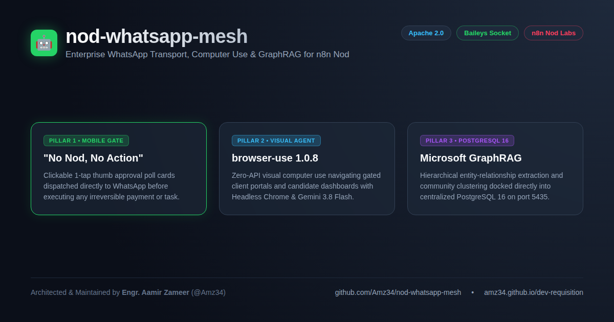
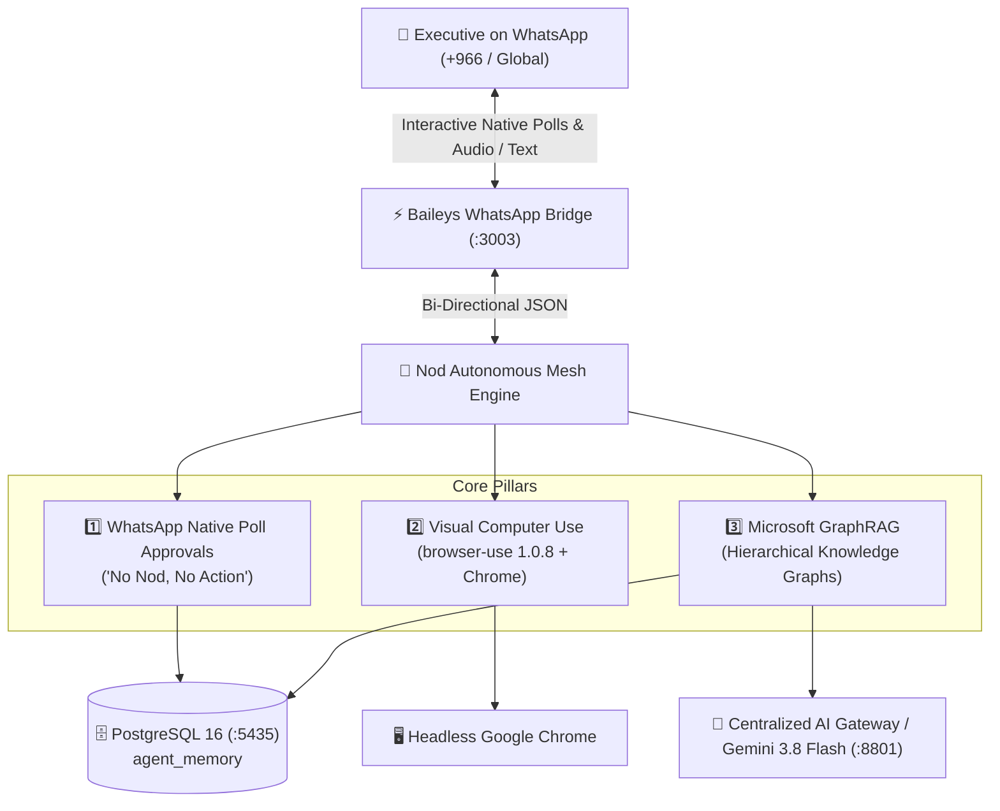

# nod-whatsapp-mesh 🤖📱

[](https://opensource.org/licenses/Apache-2.0)
[](https://github.com/whiskeysockets/baileys)
[](https://github.com/n8n-io/nod)
[](https://github.com/browser-use/browser-use)
[](https://github.com/microsoft/graphrag)
[](https://postgresql.org)
[](https://python.org)

<p align="center">
  
</p>

**Enterprise WhatsApp Baileys Transport, Computer-Use Browser Automation & Microsoft GraphRAG Mesh for n8n Nod (AI Chief of Staff).**

Transform [n8n Nod](https://github.com/n8n-io/nod) into a 24/7 mobile executive assistant on WhatsApp with **deterministic "No Nod, No Action" native interactive poll button approvals**, automated SaaS subscription leak audits, visual **[browser-use](https://github.com/browser-use/browser-use)** computer use, and **[Microsoft GraphRAG](https://github.com/microsoft/graphrag)** knowledge graphs docked into PostgreSQL 16.

---

## 🌟 The Three Enterprise Pillars

`nod-whatsapp-mesh` expands standard n8n Nod into a complete enterprise-grade autonomous operating system:



### 1. 📱 1-Tap Thumb Approvals (Native WhatsApp Polls)
Irreversible agent actions (terminating subscriptions, issuing contract proposals, executing vendor payouts) halt immediately and dispatch native clickable WhatsApp poll cards (`POST /send-poll`). **"No Nod, No Action."**

### 2. 🖥️ Visual Computer Use (`browser-use` 1.0.8)
Autonomous navigation of complex client portals, candidate ATS repositories, and government tender systems that have zero public APIs. Powered by Headless Google Chrome, DOM parsing, and visual verification judges.

### 3. 🧠 Microsoft GraphRAG Docked into PostgreSQL 16
Aggregates enterprise documents, contracts, and FinOps subscription audits into a structured Knowledge Graph. Extracts entities and relationships and clusters hierarchical communities directly into PostgreSQL 16 (`graphrag_entities`, `graphrag_relationships`, `graphrag_communities`), answering complex multi-hop executive queries over WhatsApp.

---

## 🏗️ Technical Architecture & Port Topology

| Service | Port | Protocol / Technology | Purpose |
| :--- | :--- | :--- | :--- |
| **WhatsApp Bridge** | `3003` | Node.js / Baileys WebSocket | Native WhatsApp Multi-Device Session & Poll Dispatch |
| **Nod Mesh Daemon** | `Systemd` | Python 3.11+ / asyncio | Event loops, task schedulers, approval state machine |
| **browser-use Engine**| Internal | Playwright / Headless Chrome | Visual computer use & DOM extraction |
| **GraphRAG Pipeline** | Internal | Microsoft GraphRAG / Pydantic AI | Entity/relationship extraction & community summarization |
| **n8n Automation** | `5678` | n8n Workflow Server | Complex multi-step enterprise workflows |
| **PostgreSQL 16** | `5435` | Postgres wire protocol | State ledger, subscriptions, knowledge graph tables |
| **AI Inference** | `8801` | OpenAI-compatible REST | Gemini 3.8 Flash / Claude 3.5 Sonnet / Local models |

---

## 🚀 Quickstart

### 1. Clone the Repository
```bash
git clone https://github.com/Amz34/nod-whatsapp-mesh.git
cd nod-whatsapp-mesh
```

### 2. Configure Environment (`.env`)
```bash
cp .env.example .env
```
Populate your configuration:
```env
WHATSAPP_PHONE=966574268856
GEMINI_API_KEY=your_gemini_api_key_here
GMAIL_APP_PASSWORD=your_gmail_app_password_here
POSTGRES_HOST=127.0.0.1
POSTGRES_PORT=5435
POSTGRES_DB=agent_memory
POSTGRES_USER=agent_admin
POSTGRES_PASSWORD=central_secret
```

### 3. Install Dependencies
```bash
# Node.js Baileys Bridge
npm install

# Python Environment
pip install -r requirements.txt
```

### 4. Index Knowledge Graph into PostgreSQL
```bash
python3 src/pg_graphrag_pipeline.py --index
```

### 5. Run Nod Agent Daemon
```bash
python3 src/nod_mesh.py --daemon
```

---

## 💬 Executive WhatsApp Commands

Send direct messages or commands to your WhatsApp Chief of Staff:

| Command | Action Performed |
| :--- | :--- |
| `audit` | Runs real-time SaaS & invoice audit across connected mailboxes and cloud accounts. |
| `browse <url>` | Dispatches `browser-use` visual agent to inspect target page, execute forms, or grab screenshots. |
| `ask <query>` | Queries the PostgreSQL Microsoft GraphRAG knowledge graph across all corporate data. |
| `leads` | Triages candidate profiles and incoming client RFP briefs. |
| `monitor` | Verifies uptime and visual integrity across client-facing web portals. |

---

## 🛡️ "No Nod, No Action" Trust Tripwire

The safety engine enforces a physical thumb approval gate:

1. Agent detects an actionable task (e.g. *Found unused SaaS subscriptions costing $180/mo*).
2. Agent **pauses execution** and sends a **Native Clickable Poll Button Card** directly to your WhatsApp.
3. You tap **"✅ Cancel Unused"** on your phone.
4. Bridge intercepts the poll vote event, verifies author JID, and logs the authorization receipt to PostgreSQL before performing the action.

---

## 📄 License

Licensed under the **Apache License 2.0**. See [LICENSE](LICENSE) for details.

Developed with ❤️ by **[Engr. Aamir Zameer](https://github.com/Amz34)**.
